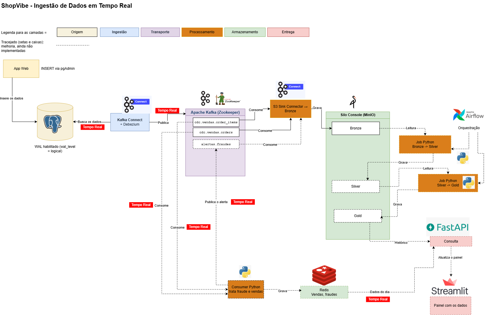

# ShopVibe — Laboratório de Engenharia de Dados

Pipeline de **CDC** com **arquitetura medalhão**.



Fonte editável do diagrama: [docs/arquitetura.drawio](docs/arquitetura.drawio).

## Status do projeto

| Componente | Status | Acesso | Login (`.env`) |
|---|---|---|---|
| Postgres | ✅ | `localhost:5432` | `POSTGRES_USER` / `POSTGRES_PASSWORD` |
| pgAdmin | ✅ | http://localhost:8091 | `PGADMIN_EMAIL` / `PGADMIN_PASSWORD` |
| Silo / MinIO (bucket `bronze`) | ✅ | http://localhost:9001 | `MINIO_USER` / `MINIO_PASSWORD` |
| Kafka + Zookeeper | ✅ | `localhost:9092` | — |
| Kafka Connect | ✅ | http://localhost:8083 | — |
| AKHQ (Kafka UI) | ✅ | http://localhost:8080 | — |
| Conector Debezium `connector-postgres` | ✅ Registrado | — | — |
| Conector S3 Sink `connector-minio` | ✅ Registrado | — | — |
| Teste ponta a ponta (INSERT → Kafka → bronze) | ✅ Validado | — | — |
| Jobs Python (bronze → silver → gold) | ⏳ Pendente | — | — |

---

## 1. Subir e parar

```powershell
Se necessario Limpar tudo
docker compose down -v                  #Apaga tudo que esta na seção de volumes

docker compose up -d        # sobe tudo
docker compose ps -a        # postgres/zookeeper/kafka-broker/connect = healthy; mc = Exited (0)
docker compose down         # para (mantém os dados)
```

O `connect` leva 1 a 2 minutos para ficar `healthy`, e o AKHQ só sobe depois dele.

> ⚠️ **`docker compose down -v` apaga tudo** (banco, Kafka, MinIO). Depois dele, refaça os passos 2 e 3.

## 2. Access key do Silo/MinIO (manual, uma vez)

O S3 Sink usa `MINIO_ACCESS_KEY` / `MINIO_SECRET_KEY`. Essa chave **não é criada automaticamente**.

1. Abra http://localhost:9001 e entre com `MINIO_USER` / `MINIO_PASSWORD`.
2. Vá em **Access Keys → Create access key**.
3. Digite os **mesmos valores** de `MINIO_ACCESS_KEY` e `MINIO_SECRET_KEY` do `.env`.

Crie a chave **antes** de registrar o S3 Sink (passo 3).

## 3. Registrar os conectores (uma vez)

A configuração fica salva no Kafka (`connect-configs`) e volta sozinha a cada `up`. Ordem: Debezium primeiro, depois o S3 Sink.

O broker está com `KAFKA_AUTO_CREATE_TOPICS_ENABLE: "false"`: os tópicos `cdc.*` só são criados pelo Debezium, no primeiro INSERT de cada tabela. Até lá, o S3 Sink fica aguardando.

```powershell
docker compose exec connect curl -s -X PUT -H "Content-Type: application/json" -d "@/conectores/conector-postgres.json" http://localhost:8083/connectors/connector-postgres/config
docker compose exec connect curl -s -X PUT -H "Content-Type: application/json" -d "@/conectores/conector-minio.json" http://localhost:8083/connectors/connector-minio/config
```

---

## 4. Testes rápidos por ferramenta

| Ferramenta | Comando | Esperado |
|---|---|---|
| Postgres | `docker compose exec postgres psql -U shopvibe -d shopvibe -c "SHOW wal_level;"` | `logical` |
| Postgres | `docker compose exec postgres psql -U shopvibe -d shopvibe -c "\dt vendas.*"` | `orders`, `order_items` |
| Postgres | `docker compose exec postgres psql -U shopvibe -d shopvibe -c "SELECT slot_name, active FROM pg_replication_slots;"` | `debezium_shopvibe \| t` |
| Zookeeper | `docker compose exec zookeeper bash -c "echo ruok \| nc localhost 2181"` | `imok` |
| Kafka | `docker compose exec kafka-broker kafka-topics --bootstrap-server localhost:9092 --list` | `connect-*` e, após INSERTs, `cdc.vendas.*` |
| Connect | `docker compose exec connect curl -s http://localhost:8083/connectors/connector-postgres/status` | `RUNNING` |
| Connect | `docker compose exec connect curl -s http://localhost:8083/connectors/connector-minio/status` | `RUNNING` |
| MinIO | `docker compose exec minio sh -c 'mc alias set local http://localhost:9000 $MINIO_ROOT_USER $MINIO_ROOT_PASSWORD >/dev/null && mc ls local'` | `bronze/` |

### Kafka: comandos básicos

```powershell
# tópicos
docker compose exec kafka-broker kafka-topics --bootstrap-server localhost:9092 --list
docker compose exec kafka-broker kafka-topics --bootstrap-server localhost:9092 --describe --topic cdc.vendas.orders

# mensagens do tópico (Ctrl + C para sair)
docker compose exec kafka-broker kafka-console-consumer --bootstrap-server localhost:9092 --topic cdc.vendas.orders --from-beginning --property print.key=true --property print.partition=true

# consumer groups (o S3 Sink é o grupo connect-connector-minio)
docker compose exec kafka-broker kafka-consumer-groups --bootstrap-server localhost:9092 --list
docker compose exec kafka-broker kafka-consumer-groups --bootstrap-server localhost:9092 --describe --group connect-connector-minio
```

Teste de producer e consumer num tópico próprio, criado antes porque a criação automática está desligada:

```powershell
docker compose exec kafka-broker kafka-topics --bootstrap-server localhost:9092 --create --topic teste --partitions 3 --replication-factor 1
docker compose exec kafka-broker kafka-console-producer --bootstrap-server localhost:9092 --topic teste
docker compose exec kafka-broker kafka-console-consumer --bootstrap-server localhost:9092 --topic teste --from-beginning
docker compose exec kafka-broker kafka-topics --bootstrap-server localhost:9092 --delete --topic teste
```

## 5. Teste do pipeline ponta a ponta

**1. Abra o AKHQ** (http://localhost:8080) em **Live Tail**.

**2. Acompanhe os eventos passando pelos tópicos.** Abra um terminal para cada tópico e deixe rodando:

```powershell
# terminal 1: pedidos
docker compose exec kafka-broker kafka-console-consumer --bootstrap-server localhost:9092 --topic cdc.vendas.orders --property print.key=true --property print.partition=true --property print.offset=true

# terminal 2: itens
docker compose exec kafka-broker kafka-console-consumer --bootstrap-server localhost:9092 --topic cdc.vendas.order_items --property print.key=true --property print.partition=true --property print.offset=true
```

Acrescente `--from-beginning` para ver também os eventos antigos. Para sair, use `Ctrl + C`.

Antes do primeiro INSERT, o consumer mostra `WARN ... UNKNOWN_TOPIC_OR_PARTITION` em loop. Isso é normal: o tópico ainda não existe, e os avisos param quando o Debezium o cria.

**3. Rode no pgAdmin** (**Query Tool** no banco `shopvibe`):

```sql
-- 3 pedidos -> 3 eventos 
INSERT INTO vendas.orders (customer_id, total) VALUES (101, 150.00), (102, 89.90), (103, 320.50);

-- 3 itens -> 3 eventos
INSERT INTO vendas.order_items (order_id, product_id, quantity, price)
SELECT o.order_id, v.product_id, v.quantity, v.price
FROM vendas.orders o
JOIN (VALUES (101,10,2,75.00), (102,20,1,89.90), (103,30,1,320.50))
  AS v(customer_id, product_id, quantity, price) USING (customer_id);

```

**Opcional: carga de 100 registros.** O arquivo [docs/carga-100.sql](docs/carga-100.sql) insere 100 pedidos e 100 itens, gerando 100 eventos em cada tópico. Use uma das duas formas:

- **PowerShell**, na pasta do projeto:
  ```powershell
  Get-Content .\docs\carga-100.sql | docker compose exec -T postgres psql -U shopvibe -d shopvibe
  ```
- **pgAdmin**: abra o arquivo no VS Code, copie todo o conteúdo, cole no **Query Tool** do banco `shopvibe` e execute com **Alt + F5**.

**4. Veja o consumer (S3 Sink) consumindo os tópicos:**

```powershell
# foto do momento (roda uma vez e sai)
docker compose exec kafka-broker kafka-consumer-groups --bootstrap-server localhost:9092 --describe --group connect-connector-minio

# acompanhamento ao vivo (atualiza a cada 2 s; Ctrl + C para sair)
while ($true) { Clear-Host; Get-Date -Format "HH:mm:ss"; docker compose exec -T kafka-broker kafka-consumer-groups --bootstrap-server localhost:9092 --describe --group connect-connector-minio; Start-Sleep 2 }
```

| Coluna | Significado |
|---|---|
| `LOG-END-OFFSET` | Total de eventos publicados no tópico |
| `CURRENT-OFFSET` | Até onde o S3 Sink já gravou na bronze |
| `LAG` | Eventos lidos mas ainda não gravados. Pode ser 1 ou 2, porque o S3 Sink só confirma o offset depois de gravar um arquivo, a cada 3 mensagens (`flush.size`). |

**5. Confira:**

| Onde | Esperado |
|---|---|
| AKHQ → Topics | `cdc.vendas.orders` e `cdc.vendas.order_items` |
| AKHQ → Consumer Groups | `connect-connector-minio` com lag ≈ 0 |
| MinIO → bronze → `topics/` | 1 arquivo `.json` por tópico (o S3 Sink grava a cada **3** mensagens) |
| Conteúdo do arquivo | `"total": "150.00"` (texto legível, não `"Ok4="`) |
